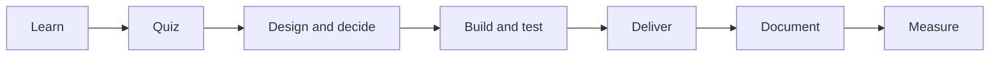

# dk-platform – Roadmap

## Where we are

*Updated with every delivery – this section is also the hand-over to a new working session.*

- **Last finished:** 0.7 – the open decisions in one table sorted by the phase that needs them
  ([below](#open-decisions)); the container engine on the laptop
  ([ADR 0008](docs/decisions/0008-container-engine-on-the-laptop.md)). Phase 0 is complete.
- **Next:** phase 1 – containers, starting with its decisions: the base image family (measured),
  the local pipeline's tools, and the photo worker's questions.
- **Then:** phase 2 – IAM with Keycloak.
- **Open decisions:** see [below](#open-decisions).
- **Production:** unchanged – the server with dk-srv (CIS Ubuntu L1 92.7 % of all rules, 100 % with
  13 accepted risks; the backend's sandbox `systemd-analyze security` 1.4).

**Starting a new AI session** (when a session gets long and its history starts being compressed):
attach the brief and the current zips of the repositories and write: *"Read the brief and the
repositories. Continue dk-platform at the step named under 'Where we are' in its ROADMAP.md."*
Everything needed lives in the repositories, not in the session.

---

## How we work

Every step goes through the same cycle; the next step starts only when I say so.

1. **Learn** – before a technology is used: what problem it solves, how it works inside, how it
   fits here, alternatives, its security relevance, the official docs. With diagrams.
2. **Quiz** – questions to check I can reproduce it.
3. **Design and decide** – the design and its open decisions. For each decision the options are
   laid out with the information that matters; then I decide, and the decision is recorded with
   its reasoning as an ADR in [`docs/decisions/`](docs/decisions/)
   ([ADR 0001](docs/decisions/0001-record-decisions-as-madr.md)).
4. **Build and test** – in a sandbox first; secret scanning (gitleaks), linters, scanners.
5. **Deliver** – I apply every change myself: patches (`git diff --binary`) for existing
   repositories, zips for new ones; with every delivery a list of every file and what changed in
   it, and the exact commands and where to run them (laptop / server / cluster).
6. **Document** – in the same change: READMEs, this roadmap (✅), SECURITY, HARDENING, the commands
   files, ADRs, diagrams. Obsolete things are removed.
7. **Measure** – before and after where possible: benchmark scores, CVE counts, image sizes, RAM per
   pod.

Ground rules: production keeps running and stays secure the whole time; no secret and no domain in
any repository, patch or AI session; nothing about the production server that a reader doesn't need
and an attacker could use – no addresses, no size, no provider, no upgrade plans (those live in
dk-platform-env); fix what reaches the running app, no workarounds for unimportant
findings (e.g. development-only tools); current versions and docs are checked, not remembered.

Status marks: ✅ done · 🔄 in progress · 🔜 planned

---

## Phases

| # | Phase | Where | Status |
|---|---|---|---|
| 0 | Foundations: repositories, threat model, decisions, RAM budget | laptop | ✅ |
| 1 | Containers: hardened images, Compose, the photo worker | laptop | 🔜 |
| 2 | IAM with Keycloak (still in Compose) | laptop | 🔜 |
| 3 | Kubernetes basics with k3d | laptop | 🔜 |
| 4 | Cluster security, measured before/after | laptop | 🔜 |
| 5 | CI/CD and GitOps, signed images | GitHub, laptop | 🔜 |
| 6 | Observability and runtime security | laptop | 🔜 |
| 7 | Go-live on the production server, cutover | server | 🔜 |
| 8 | AWS with Terraform, time-boxed | AWS | 🔜 |

No fixed weeks – built alongside daily life. Nothing is deployed to the server before phase 7.

### 0. Foundations ✅

| Step | What | |
|---|---|---|
| 0.1 | Read storybook and dk-srv; a summary of what the move has to handle ([architecture](docs/architecture.md#what-the-move-has-to-handle)) | ✅ |
| 0.2 | Learning map; first explanation: containers, Kubernetes, IAM, the target architecture | ✅ |
| 0.3 | This repository: documents, ADRs 0001–0004, the "now" and "target" pictures; dk-platform-env's README | ✅ |
| 0.4 | Pictures for storybook (how it runs; uploading a photo) and dk-srv (the host at a glance; the nightly security check), in Mermaid | ✅ |
| 0.5 | Threat model: data flows, STRIDE per element and a LINDDUN pass, 54 + 7 threats rated, 59 requirements with checks ([ADR 0005](docs/decisions/0005-threat-modelling-method.md)) | ✅ |
| 0.6 | RAM and disk budget: what each component needs – estimated now, measured per pod in phases 1–6 ([budget](docs/resource-budget.md)); resource policy ([ADR 0006](docs/decisions/0006-resource-policy.md)); backups pulled by a sidekick server ([ADR 0007](docs/decisions/0007-backups-pulled-to-a-sidekick-server.md)) | ✅ |
| 0.7 | The open decisions in one table sorted by the phase that needs them; the container engine on the laptop ([ADR 0008](docs/decisions/0008-container-engine-on-the-laptop.md)) | ✅ |

### 1. Containers 🔜

- learn: images and layers, namespaces, cgroups, seccomp, capabilities (and how they map to the
  backend's systemd sandbox today)
- Docker Engine on the laptop, rootful to start with
  ([ADR 0008](docs/decisions/0008-container-engine-on-the-laptop.md))
- the base image family, chosen by measurement: the same image built on two or three candidates,
  compared by size and Trivy's CVE counts
- multi-stage Dockerfiles: frontend (React build in an unprivileged nginx), backend, photo worker,
  dk-home; non-root, minimal or distroless bases, read-only root filesystem, no shell
- the **photo worker**: conversion out of the backend into its own process, jobs through a
  PostgreSQL queue (`SELECT … FOR UPDATE SKIP LOCKED`), attempts counted so a broken photo can't
  crash it forever; the app copes with photos that aren't converted yet
- Docker Compose for all parts
- hadolint, Trivy; measured: image size and CVE counts per image
- a **small local pipeline** – build, lint, scan, measure on every change – as a first, hands-on
  start of the CI/CD that phase 5 takes to GitHub

### 2. IAM with Keycloak (in Compose) 🔜

- learn: OAuth 2.0 and OpenID Connect, Authorization Code + PKCE, tokens and their lifetimes
- the BFF pattern: tokens stay in the backend, the browser keeps its httpOnly session cookie
- MFA: passkeys (WebAuthn) and/or codes
- Keycloak hardening: admin console not public, own realm, brute-force detection, own database
- moving the few existing users (Keycloak can't read the bcrypt hashes as they are)
- groundwork for per-user read/edit permissions per storybook: what Keycloak knows, what the app
  decides

### 3. Kubernetes basics with k3d 🔜

- Deployments, Services, Ingress (or Gateway API), ConfigMaps, Secrets, StatefulSet, volumes,
  probes, requests and limits, Jobs and CronJobs
- Traefik and cert-manager in place of nginx and certbot
- backup and restore-test CronJobs (age-encrypted, pulled to the laptop like today; monthly restore
  test; from phase 7 pulled by the sidekick server –
  [ADR 0007](docs/decisions/0007-backups-pulled-to-a-sidekick-server.md))
- maintenance mode and lockdown as Kubernetes actions
- dk-platform-env gets its first content (the local environment)

### 4. Cluster security 🔜

RBAC and ServiceAccounts · Pod Security Standards "restricted" · Cilium: default-deny and egress by
DNS name · Kyverno · a WAF (Coraza with the OWASP Core Rule Set, detection first, then blocking) ·
SOPS + age · Vault (Kubernetes auth, short-lived database credentials) · Secrets encrypted at rest ·
the API server's audit log · requests and limits on every pod, a Kyverno rule refusing BestEffort
pods ([ADR 0006](docs/decisions/0006-resource-policy.md)) · kube-bench (k3s profile, CIS Kubernetes
Benchmark), Kubescape (configuration only), Trivy Operator – **measured before and after**, like USG on the host ([SECURITY.md](SECURITY.md)).

### 5. CI/CD and GitOps 🔜

GitHub Actions with Semgrep, Trivy, gitleaks · SBOMs (syft) · cosign keyless signing through
GitHub's OIDC (no keys to manage) · build provenance attestations · Renovate for image digests ·
Argo CD with single sign-on through Keycloak · Kyverno admits only signed images · how the local
pipeline from phase 1 and GitHub Actions fit together.

### 6. Observability and runtime security 🔜

Prometheus, Grafana, Alertmanager → ntfy · Loki · Falco · single sign-on for Grafana · replacements
for dk-srv's site watch and notifications.

### 7. Go-live 🔜

On a production server sized by the measurements of phases 3–6: dk-srv
adapted for a k3s node (forwarding on, the pod and service networks in the firewall, image
registries and Let's Encrypt in the egress rules, AIDE/auditd exclusions for k3s's folders,
fail2ban's nginx jails replaced, USG measured again) · an inventory of the host's packages
(`apt-mark showmanual`) in dk-srv, so a new server is set up from a list · the sidekick server for
the backups ([ADR 0007](docs/decisions/0007-backups-pulled-to-a-sidekick-server.md)), hardened with
dk-srv · migration rehearsal (database, photos) ·
cutover with the old server as the way back · runbooks in
[`maintenance-commands.md`](maintenance-commands.md).

### 8. AWS with Terraform (time-boxed) 🔜

AWS IAM in depth (policies, roles, IAM Identity Center, GitHub Actions → AWS through OIDC without
access keys, EKS Pod Identity/IRSA) · KMS, CloudTrail, GuardDuty, Security Hub (CIS AWS Foundations)
· IaC scanning on the Terraform. Cost guardrails from day 1: a budget alert, tags on everything,
`terraform destroy` after every session, watch out for NAT gateways, load balancers and leftover
volumes.

---

## Open decisions

Sorted by the phase that needs each decision – decided at the last responsible moment, when the
facts are there but nothing has been built on a guess yet. Each becomes an ADR when its phase comes
– with the options laid out first – and then leaves this table. Every phase also works
through its part of [`docs/security-requirements.md`](docs/security-requirements.md), and ends with a
review of the [threat model](docs/threat-model.md).

| Needed in | Decision | Options known so far | Related |
|---|---|---|---|
| 1 | The base image family | Debian slim, Alpine, Google distroless, Docker Hardened Images, Chainguard (free: `latest` only); two or three compared by image size and CVE counts, exceptions allowed per image | R-30 |
| 1 | The local pipeline: its tools and steps | a Makefile or script, the pre-commit framework, the GitHub Actions workflows run locally, a small CI server in a container | R-26, R-30 |
| 1 | How a photo's GPS position becomes its town when the worker may not reach the internet (exact positions are never stored; the rounding is decided in R-17) | the worker hands the position over · the backend reads it · the worker may reach Nominatim | T-17, T-18 |
| 1 | The worker's image: exiftool needs Perl | a minimal image with Perl, or another way to read and strip GPS data | T-13 |
| 1 | The originals' other metadata: removed or kept | removed · kept deliberately | R-19, T-19 |
| 1 / 3 | Who serves the photos after the login check | frontend nginx or backend; Traefik's ForwardAuth asks the backend either way | R-06 |
| 2 | How the existing users move to Keycloak | new passwords or passkeys, or a provider that reads bcrypt | TT-07 |
| before 3 | The Kubernetes distribution | k3s, RKE2, kubeadm, Talos; k3d (the local cluster) only runs k3s | |
| before 3 | When and how far the laptop moves to rootless Docker | the image builds and Compose only, or the k3d cluster too – k3d on rootless Docker is undocumented, Cilium and Falco need eBPF in the host's kernel | [ADR 0008](docs/decisions/0008-container-engine-on-the-laptop.md), P2 |
| 3 | Ingress, Gateway API or Traefik's own routes | | |
| 3 | PostgreSQL as a plain StatefulSet or with an operator | e.g. CloudNativePG | |
| 3 | How the real client IP reaches the backend through k3s's load balancer and Traefik | otherwise the login limiter sees one IP for everyone | R-02 |
| 3 | How long logs with IP addresses are kept | Loki's retention follows from it (30 days assumed in the budget) | R-47, T-50 |
| 4 | The admin path to the Kubernetes API | an SSH tunnel or a VPN | R-37, T-38 |
| 4 | Vault or OpenBao | the owner leans to Vault | R-29 |
| 4 | Vault's agent injector or a secrets operator | sized in the [budget](docs/resource-budget.md) as one small pod | R-29 |
| after 4's measurements | kube-bench nightly or on demand, and whether Kubescape stays | on demand would work like USG on today's host: after k3s upgrades and configuration changes; a change to the nightly run supersedes part of ADR 0006 and changes R-51 | [ADR 0006](docs/decisions/0006-resource-policy.md), R-51 |
| 5 | How the local pipeline and GitHub Actions fit together | pre-commit hooks (gitleaks, linters), the CI workflows run locally, a pipeline in k3d | R-26, R-33 |
| 6 | Notifications: what goes through ntfy, and where ntfy and the outside uptime check run – they must keep working when the node is down | minimal text on ntfy.sh · ntfy on our own server; the sidekick server is a candidate; a third-party service there needs a new ADR first ([ADR 0004](docs/decisions/0004-one-platform-for-all-apps.md)) | R-46, R-48, T-49 |
| before 7 | The production server's size | from the measured RAM and disk per pod; recorded in dk-platform-env | [budget](docs/resource-budget.md) |
| when wanted | Third-party services on the platform (e.g. a voice server, a VPN for own access) | a new ADR first | [ADR 0004](docs/decisions/0004-one-platform-for-all-apps.md) |
| with a second node | Object storage for the photos | a ReadWriteOnce volume works on one node only | |
