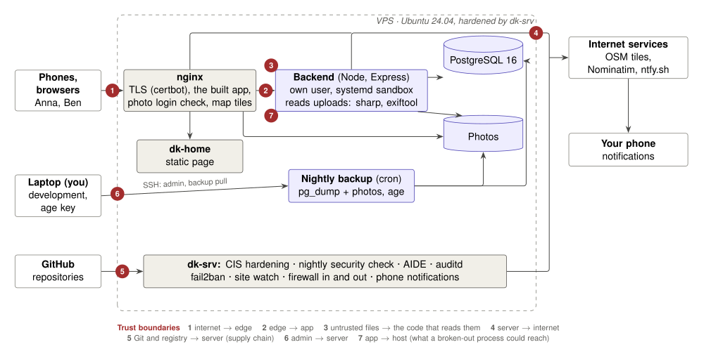
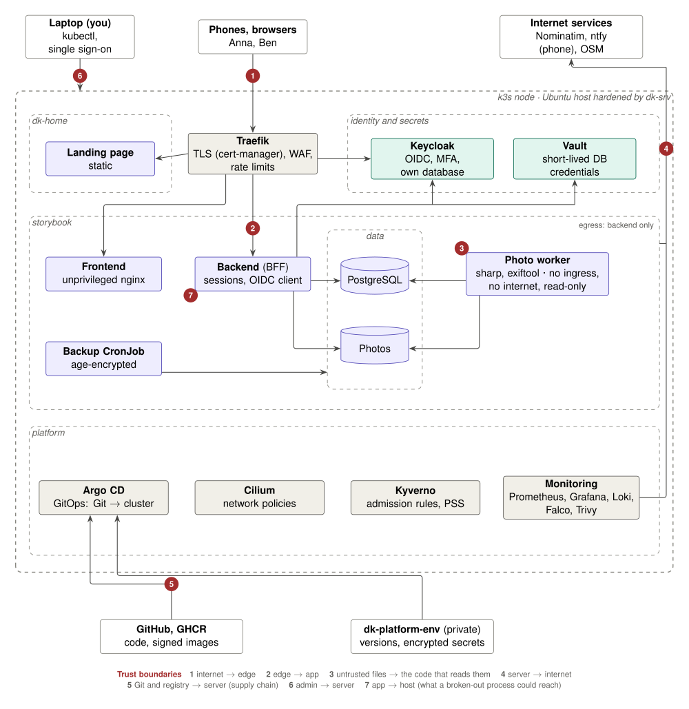

# Architecture: now and target

The pictures are built from [`diagrams/now.tex`](diagrams/now.tex) and
[`diagrams/target.tex`](diagrams/target.tex). The red numbers are the trust boundaries – the same
number means the same boundary in both.

## Now: one hardened VPS

| Component | What it does | Where it's described |
|---|---|---|
| nginx | TLS (certbot), serves the built app and the landing page, checks the login before every photo (`auth_request`), proxies and caches the map tiles, rate limits | storybook `ops/root/nginx/`, dk-srv `nginx/` |
| Backend | Node.js/Express; the API, logins (session cookie, bcrypt), and – inside the same process – the photo conversion (sharp) and GPS removal (exiftool); runs as its own user in a systemd sandbox (`systemd-analyze security` 1.4) | storybook `server/`, `ops/root/storybook.service` |
| PostgreSQL 16 | one database, one schema per storybook | storybook `server/migrations/` |
| Photos | `/etc/storybook/uploads/book_<n>/`, written by the backend, read by nginx | storybook `ops/README.md` |
| Nightly backup | `pg_dump` + photos, age-encrypted; pulled to the laptop with a read-only key; monthly restore test | storybook `ops/backup.sh` |
| dk-home | the landing page, a static site that nginx serves at the domain root (the storybook has its own host name) | dk-home, dk-srv `dk-site-update` |
| dk-srv | CIS hardening (USG: 92.7 % of all rules, 100 % with 13 accepted risks), nightly security check, maintenance mode and lockdown, AIDE, auditd, fail2ban, site watch, firewall in and out, phone notifications | dk-srv |

## Target: a hardened k3s node

One cluster for all apps on the domain, one namespace per app
([ADR 0004](decisions/0004-one-platform-for-all-apps.md)). Each component gets a README next to its
configuration ([template](templates/component-readme.md)); the column "README" says where.

| Component | What it does | Phase | README |
|---|---|---|---|
| Traefik | the edge: TLS, routing by host name, rate limits, the login check before photos (ForwardAuth), the WAF | 3, 4 | `platform/traefik/` |
| cert-manager | certificates from Let's Encrypt, renewed by itself | 3 | `platform/cert-manager/` |
| Frontend | the React build in an unprivileged nginx | 1, 3 | storybook `deploy/` |
| Backend (BFF) | the API; keeps the login session; talks to Keycloak as an OIDC client; gets its database credentials from Vault | 1–4 | storybook `deploy/` |
| Photo worker | converts uploads and removes GPS data – isolated: no incoming connections, no internet, read-only filesystem, tight memory limit; jobs from a PostgreSQL queue | 1, 3, 4 | storybook `deploy/` |
| PostgreSQL | StatefulSet with a persistent volume | 3 | storybook `deploy/` |
| Photos volume | originals and small versions; ReadWriteOnce, so backend and worker share one node | 3 | storybook `deploy/` |
| Backup CronJob | dump + photos, age-encrypted; restore test monthly; pulled by a sidekick server ([ADR 0007](decisions/0007-backups-pulled-to-a-sidekick-server.md)) | 3 | storybook `deploy/` |
| Landing page | dk-home as a small static container, served at the domain root | 1, 3 | dk-home |
| Keycloak | identities: logins for the apps (OIDC), MFA/passkeys, single sign-on for Argo CD and Grafana, `kubectl` login | 2, 4 | `platform/keycloak/` |
| Vault | secrets: short-lived database credentials, Kubernetes auth | 4 | `platform/vault/` |
| Cilium | the network: default-deny between pods, egress by DNS name | 4 | `platform/cilium/` |
| Kyverno | admission rules: what may run (Pod Security Standards, signed images only, …) | 4, 5 | `platform/kyverno/` |
| Argo CD | GitOps: the cluster follows Git (dk-platform and dk-platform-env) | 5 | `platform/argocd/` |
| Monitoring | Prometheus, Alertmanager → ntfy, Grafana, Loki, Falco, Trivy Operator | 4, 6 | `platform/monitoring/` and per tool |
| The host | Ubuntu with dk-srv, adapted for a k3s node | 7 | dk-srv |

## Trust boundaries

| # | Boundary | Now | Target |
|---|---|---|---|
| 1 | internet → edge | phones → nginx | phones → Traefik (TLS, WAF, rate limits) |
| 2 | edge → app | nginx → backend on 127.0.0.1 | Traefik → frontend/backend, only what NetworkPolicies allow |
| 3 | untrusted files → the code that reads them | inside the backend process | only the photo worker, isolated |
| 4 | server → internet | ufw egress for the whole server | per pod, by DNS name (Cilium); only the backend and the alerts |
| 5 | Git and registry → server | `git pull`, root-owned copies (`dk-app-update`) | Argo CD; signed images only (Kyverno) |
| 6 | admin → server | SSH with keys | SSH, `kubectl` with OIDC and RBAC, single sign-on |
| 7 | app → host | systemd sandbox | container: PSS "restricted", seccomp, non-root, read-only; Falco watches |

The [threat model](threat-model.md) goes through the flows across these boundaries, with STRIDE and,
for personal data, LINDDUN.

## Today → target

| Today | In Kubernetes |
|---|---|
| systemd service + sandbox | Deployment + `securityContext` + Pod Security Standards |
| nginx site, `auth_request`, `limit_req` | Traefik routes, ForwardAuth, rate-limit and WAF middlewares |
| certbot | cert-manager |
| ufw egress rules (whole server) | Cilium policies per pod, by DNS name |
| `server/.env`, `/etc/storybook/*.conf` | Secrets and ConfigMaps (SOPS, Vault) |
| cron backup | CronJob |
| `storybook-mode maintenance` | backend scaled to 0 + a maintenance route |
| `dk-app-update` (root-owned copy) | Argo CD + signed images |
| AIDE on the app's files, nightly `npm audit` | immutable signed images, Trivy in CI and in the cluster, Falco |
| fail2ban on the login | Keycloak brute-force detection, Traefik rate limits, WAF |
| ntfy from scripts | Alertmanager → ntfy |

## What the move has to handle

Found while reading the repositories (step 0.1):

1. **The backend reaches more than PostgreSQL**: Nominatim (place search, and the town of an
   uploaded photo) and ntfy.sh; nginx fetches the map tiles from OpenStreetMap. Three internet
   names, split between components.
2. **exiftool also reads untrusted uploads** (`server/src/places.js`) – the worker gets two
   parsers, sharp/libvips and exiftool, and exiftool needs Perl.
3. **Isolated worker vs. "exact positions are never stored"**: turning a GPS position into a town
   needs Nominatim; a worker without internet would have to hand the position over (open decision).
4. **Uploads become asynchronous**: small versions, sizes and places are made inside the upload
   request today; with a queue the app has to cope with "not converted yet".
5. **The visitor's IP**: the backend trusts only `loopback` as proxy; behind Traefik and k3s's load
   balancer every visitor could look the same again (the problem of storybook step 1).
6. **Fixed host paths**: the photos folder in production, the umask 022 for nginx; the settings
   files already have overrides (`SITE_CONF`, `NOTIFY_CONF`).
7. **State in the process**: the login limiter and the session cache – fine with one backend
   replica.
8. **The login is half a BFF already**: a server-side session with a hashed `__Host-` cookie;
   Keycloak changes how people log in, not the session. The old JWT exchange can go first.
9. **The admin scripts** (`storybook-run`: migrate, sessions, user:password) become Jobs or
   controlled `kubectl` actions.
10. **dk-srv's app model** (`apps.d`: systemd service, nginx sites, npm folders) changes for apps in
    the cluster.
