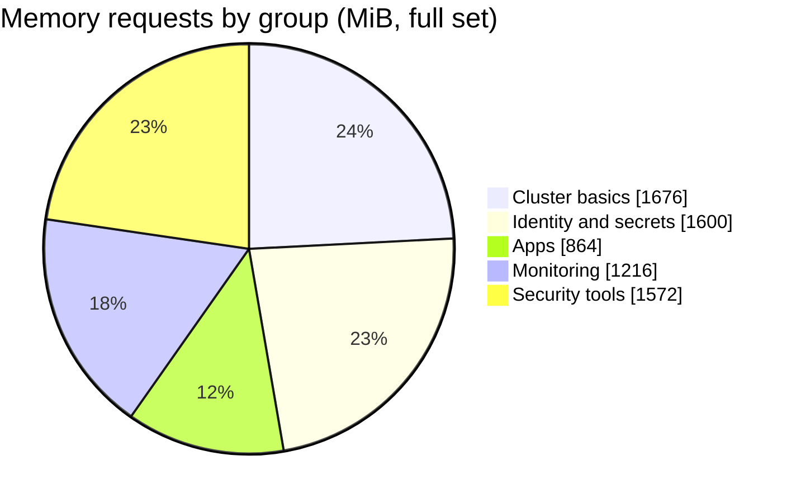

# Resource budget: RAM and disk

What each component of the [target](architecture.md#target-a-hardened-k3s-node) needs, so the
production server can be sized from facts (phase 7). The rules – which pods are Guaranteed, how
the scanners run, how much of the node may be promised – are in
[ADR 0006](decisions/0006-resource-policy.md); where the backups go, in
[ADR 0007](decisions/0007-backups-pulled-to-a-sidekick-server.md).

**Status:** first version, 2026-11-23 (phase 0) – **estimates**. Every row is measured in the phase
named and the "Measured" column filled in; the totals are then recalculated. The production
server's own size and the comparison with this budget are kept in dk-platform-env, not here.

## How to read it

- **Request** – what the scheduler reserves for the pod; the sum of all requests must stay at or
  below 80 % of the node's allocatable memory (ADR 0006). **Limit** – where the kernel stops the
  container (OOM kill). Both in MiB.
- **QoS** – Guaranteed (request = limit; the last to be evicted) or Burstable (request below the
  limit). BestEffort (no request at all) is refused by a Kyverno rule.
- **Source** – *chart* = the Helm chart's or k3s's own default; *docs* = the project's sizing
  guide; *estimate* = a first guess from experience with similar components, to be measured.
- **Measured** – the pod's working set under normal use (`kubectl top pod`, Grafana), filled in by
  the phase named.

The runtimes are told about their limit, so they don't grow into it blindly: Keycloak's JVM takes
70 % of the limit as heap (`MaxRAMPercentage`), the Node.js backend gets `--max-old-space-size`,
Go programs (most platform tools) read `GOMEMLIMIT`.

## RAM

### The node's own share

Not pods – this memory is set aside (`system-reserved`, `kube-reserved`) so it isn't promised to
pods.

| Part | MiB | Source | Measure in |
|---|---|---|---|
| Ubuntu and dk-srv's tools (sshd, auditd, fail2ban, journald, unattended-upgrades) | ~400 | estimate | 7 (`free`, `systemd-cgtop`) |
| AIDE's nightly run, on top | ~300 | estimate | 7 |
| k3s: API server, controllers, scheduler, the SQLite datastore (kine), kubelet, containerd | ~1520 | docs: [K3s resource profiling](https://docs.k3s.io/reference/resource-profiling), 1596 MB for a server with a workload | 3 |
| Eviction threshold: the kubelet starts evicting pods below this much free memory | 100 | kubelet default `memory.available<100Mi` | – |

### Permanent pods

| Group | Component | Request | Limit | QoS | Source | Measure in | Measured |
|---|---|---|---|---|---|---|---|
| Cluster basics | CoreDNS | 70 | 170 | Burstable | chart (k3s) | 3 | |
| | metrics-server | 70 | 150 | Burstable | request: chart (k3s); limit: estimate | 3 | |
| | local-path-provisioner | 32 | 64 | Burstable | estimate (k3s sets none) | 3 | |
| | Cilium agent | 384 | 384 | Guaranteed | estimate (chart sets none) | 4 | |
| | Cilium operator | 128 | 128 | Guaranteed | estimate (chart sets none) | 4 | |
| | Traefik with the Coraza WAF (WASM) | 128 | 384 | Burstable | estimate – the rule set in WASM adds to Traefik's own few dozen MiB | 4 | |
| | cert-manager: controller, webhook, cainjector | 96 | 384 | Burstable | estimate (chart sets none) | 3 | |
| | Kyverno: admission, background, cleanup, reports controllers | 320 | 768 | Burstable | chart | 4 | |
| | Argo CD: application controller, repo server, server, Redis, ApplicationSet | 448 | 1280 | Burstable | estimate (chart sets none) | 5 | |
| Identity and secrets | Keycloak | 1024 | 1024 | Guaranteed | docs: [Keycloak sizing](https://www.keycloak.org/high-availability/concepts-memory-and-cpu-sizing) – about 1 GB for an idle pod; heap = 70 % of the limit, plus ~300 MB outside the heap | 2 (Compose), 3 | |
| | Keycloak's PostgreSQL | 256 | 256 | Guaranteed | estimate | 2, 3 | |
| | Vault | 256 | 256 | Guaranteed | estimate (chart sets none) | 4 | |
| | Vault's injector or secrets operator | 64 | 128 | Burstable | estimate – which one is decided in phase 4 | 4 | |
| Apps | PostgreSQL (storybook) | 512 | 512 | Guaranteed | estimate – shared buffers plus connections | 1 (Compose), 3 | |
| | backend (Node.js) | 192 | 384 | Burstable | estimate | 1, 3 | |
| | frontend (nginx, static files) | 16 | 64 | Burstable | estimate | 1 | |
| | dk-home (nginx, static files) | 16 | 64 | Burstable | estimate | 1 | |
| | photo worker (libvips, exiftool) | 128 | 1024 | Burstable | estimate – idle small, converting a large photo high; the limit is sized to the largest photo allowed | 1 | |
| Monitoring | Prometheus | 512 | 1024 | Burstable | estimate (chart sets none) – grows with the number of series | 6 | |
| | Prometheus operator, kube-state-metrics, node-exporter, Alertmanager | 192 | 384 | Burstable | estimate | 6 | |
| | Grafana | 128 | 256 | Burstable | estimate (chart sets none) | 6 | |
| | Loki (single binary) | 256 | 512 | Burstable | estimate (chart sets none) | 6 | |
| | Alloy (collects the logs) | 128 | 256 | Burstable | estimate; its config reloader 50 by chart | 6 | |
| Security tools | Falco | 512 | 1024 | Burstable | chart | 6 | |
| | Trivy Operator | 128 | 256 | Burstable | estimate (chart sets none for the operator) | 4 | |
| | Kubescape operator, configuration scanning only: kubescape, operator, storage, scheduler | **932** | **2952** | Burstable | chart – see the note below | 4 | |

**Kubescape is heavier than first thought.** Even with configuration scanning only, its chart's
defaults request about 0.9 GiB (kubescape 400, storage 400, operator 100, scheduler 32) with limits
near 2.9 GiB – the earlier guess was about 0.6 GiB. Its other capabilities (vulnerability scanning,
runtime observability, node scanning, SBOMs, its own admission controller …) are on by default and
are switched off (ADR 0006); whether it stays at all is reviewed after phase 4.

### Jobs – they run, then they're gone

| Job | When | Request | Limit | Source | Measure in |
|---|---|---|---|---|---|
| Backup (dump, photos, encryption; the monthly restore test) | nightly | 64 | 512 | estimate | 3 |
| Trivy scan job – one at a time (`scanJobsConcurrentLimit: 1`) | after a new image; rescans when a report is older than 24 h | 96 | 477 | chart (100M / 500M) | 4 |
| kube-bench | nightly | 64 | 128 | estimate (the job sets none) | 4 |
| Kubescape's scan | nightly – runs inside the kubescape pod, up to its limit | – | – | above | 4 |

### Totals

| | Requests | Limits |
|---|---|---|
| Cluster basics | 1676 | 3712 |
| Identity and secrets | 1600 | 1664 |
| Apps | 864 | 2048 |
| **Core** (the three above – what the apps need to run) | **4140** | **7424** |
| Monitoring | 1216 | 2432 |
| Security tools | 1572 | 4232 |
| **Full set** (everything in this plan) | **6928** | **14088** |

**What a node needs** (requests ÷ 0.8, plus the node's own share of ~2020 MiB):

| Set | Requests | Allocatable needed (requests ≤ 80 %) | Node RAM needed |
|---|---|---|---|
| Core | 4140 MiB | ~5200 MiB | **~7.0 GiB** |
| Full set | 6928 MiB | ~8700 MiB | **~10.4 GiB** |
| Full set without Kubescape | 5996 MiB | ~7500 MiB | ~9.3 GiB |

Limits add up to far more than the node has – that's normal (overcommitment): not every pod hits
its limit at the same time. The 20 % between the requests and the allocatable memory is the room
for those bursts.

### Peaks that can coincide

The night is the busy time. If everything ran at once, on top of the requests:

| What | Extra at most (MiB) |
|---|---|
| Backup job up to its limit | ~450 |
| A Trivy scan job | ~380 |
| kube-bench | ~65 |
| Kubescape's scan, up to its limits | ~2000 |
| AIDE on the host | ~300 |
| Someone uploading many photos at night: the worker up to its limit | ~900 |

**Rule:** the nightly jobs get separate times (the backup first, then kube-bench, then Kubescape –
its chart's default of 08:00 UTC is moved into the night; AIDE stays where dk-srv runs it), so at
most one heavy job runs at a time. Checked in phase 6: the node's free memory over a night in
Grafana, no evictions, no OOM kills.

## Disk

| What | Grows with | Kept | Estimate | Source | Measure in |
|---|---|---|---|---|---|
| Ubuntu, dk-srv, logs on the host | updates, journald | journald's limits | ~5 GiB | estimate | 7 |
| k3s and container images | every image version pulled | the kubelet removes unused images above 85 % disk use (its default) | ~8 GiB | estimate – Keycloak, Falco and the monitoring images are the big ones | 3–6 |
| Trivy's vulnerability database | daily update | one copy per scan job, deleted with the job | ~1 GiB, while a scan runs | estimate | 4 |
| Prometheus | number of series × time | **10 days** (the chart's default) and a size cap (`retentionSize`, the chart sets none) | ~2 GiB | chart; estimate | 6 |
| Alertmanager | alerts | 120 hours (chart) | small | chart | 6 |
| Loki | log lines | **the chart deletes nothing by default** – a retention period is set; 30 days assumed until R-47 is decided | ~3 GiB | chart; estimate | 6 |
| PostgreSQL (storybook), Keycloak's PostgreSQL | content | – | in dk-platform-env | – | 3 |
| Photos (originals and the small versions) | uploads | – | in dk-platform-env | – | 3 |
| Backups on the node | dumps, photos | **ADR 0007:** the encrypted dumps of a few days and the encrypted photo copies of a few days; the full history lives on the sidekick server | a few dumps plus a few days of new photos | – | 7 |

**Today's backups double the photos:** every original is kept a second time, encrypted, on the
server, forever. With ADR 0007 the node keeps only the last days; the complete, append-only copy is
on the sidekick server – the node's disk no longer grows with the photo history twice.

**Disk alerts** (phase 6): above 80 % of the volume, a warning; Prometheus's and Loki's size caps
keep them from filling it (threat T-53, requirement R-50).

## Next

Phase 1 measures the containers in Compose (backend, frontend, worker, PostgreSQL); phases 2–6 the
rest, in k3d. Every measurement replaces an estimate here; when the totals are final, the
production server is sized from them (phase 7, recorded in dk-platform-env).
