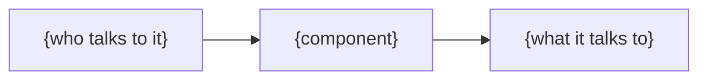

# {Component}

*Template for the README next to each platform component's configuration
(e.g. `platform/traefik/README.md`). Remove this line and the parts in braces.*

{One sentence: what it is.}

| | |
|---|---|
| Version | {version, and where it's pinned} |
| Namespace | {namespace} |
| Installed by | {Argo CD application / Helm chart and values file} |
| Decision | {ADR link} |
| Phase | {phase and step} |

## What it does here

{What problem it solves in this platform, in plain words. What would be missing without it.}

## How it's built

{The parts (pods, services, CRDs), how they work together, and how it connects to the rest – a
Mermaid picture if it helps.}

## Why this way

{The main choices and their reasons; link the ADRs. The alternatives that were considered.}

## Where the configuration is

| File | What's in it |
|---|---|
| `{values.yaml}` | {…} |
| `dk-platform-env/{…}` | {the environment's part: host names, secrets (encrypted)} |

## Hardening

| Mechanism | Guide / rule | Check it yourself |
|---|---|---|
| {e.g. runs as non-root, read-only filesystem} | {e.g. PSS restricted, CIS 5.x} | `{command}` → {expected} |

Details: [`HARDENING.md`](../../HARDENING.md); scores and accepted risks:
[`SECURITY.md`](../../SECURITY.md).

## Operating it

- **Is it healthy?** `{command}`
- **Logs:** `{command}`
- **Updating:** {how – usually a Renovate pull request, then Argo CD}
- **When it breaks:** {link to the situation in `maintenance-commands.md`}

## Official docs

- {links}
