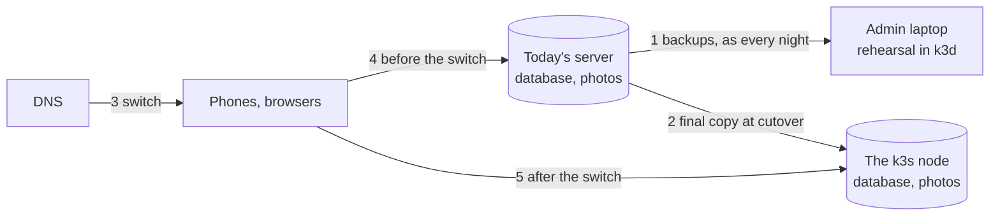

# Threat model: the transition

The risks that exist only while moving from today's server to the platform: the migration
rehearsal, two systems side by side, the cutover, a possible rollback, and retiring the old server.
Same method and rating as the [threat model of the target](threat-model.md)
([ADR 0005](decisions/0005-threat-modelling-method.md)); requirements R-53 to R-59 in
[`security-requirements.md`](security-requirements.md#phase-7-go-live-and-the-transition). These
threats end with the cutover and the old server's retirement (phase 7).

| ID | Element / flow | Letter | Threat | L | I | P | Response | R |
|---|---|---|---|---|---|---|---|---|
| TT-01 | flow 2 | I, T | the final copy of the database and photos read or changed on its way | L | H | M | mitigate | R-53 |
| TT-02 | flows 4, 5 | T, D | users write to both systems around the switch: changes lost or split | M | M | M | mitigate | R-54 |
| TT-03 | laptop | I | real data used for the rehearsal lies around unencrypted afterwards | M | M | M | mitigate | R-55 |
| TT-04 | flow 3 | S, D | the DNS switch goes wrong: certificates not ready, old answers cached for long, a typo sends users elsewhere | M | M | M | mitigate | R-56 |
| TT-05 | old server | I · LINDDUN: data disclosure | the retired server's disk, the provider's snapshots, or still-valid keys and tokens keep the data reachable | M | H | **H** | mitigate | R-57 |
| TT-06 | rollback | D, T | a rollback loses what was written on the new system, or brings back an outdated state | L | M | L | mitigate | R-58 |
| TT-07 | users | S | the move to Keycloak means "please set a new password or passkey" – a message a phisher could imitate | L | H | M | mitigate | R-59 |

**Review:** before the rehearsal (phase 7) and once more after the old server is retired, when
this document is marked as closed.
