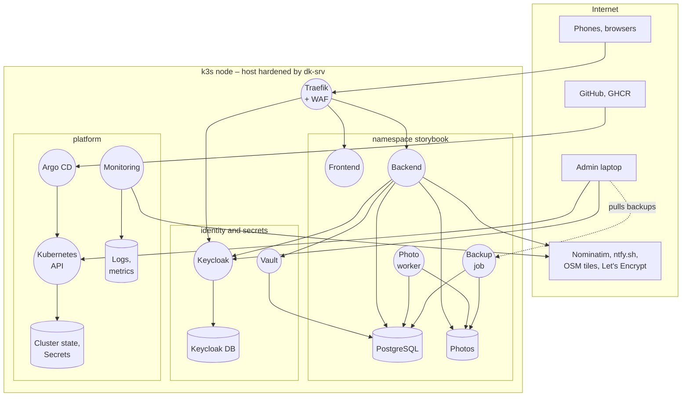
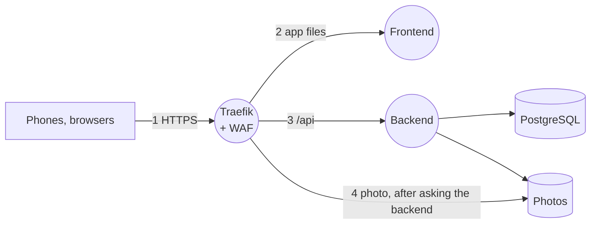
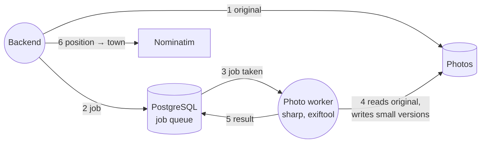
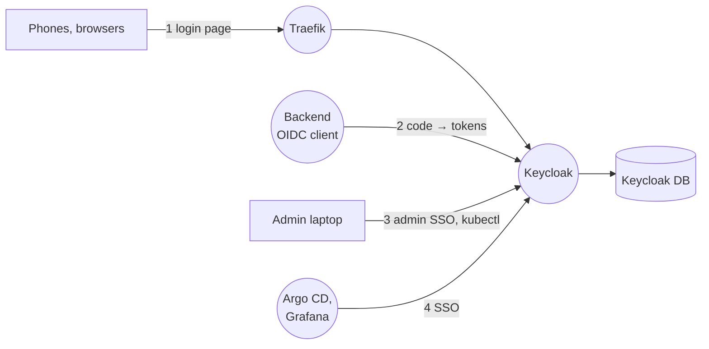
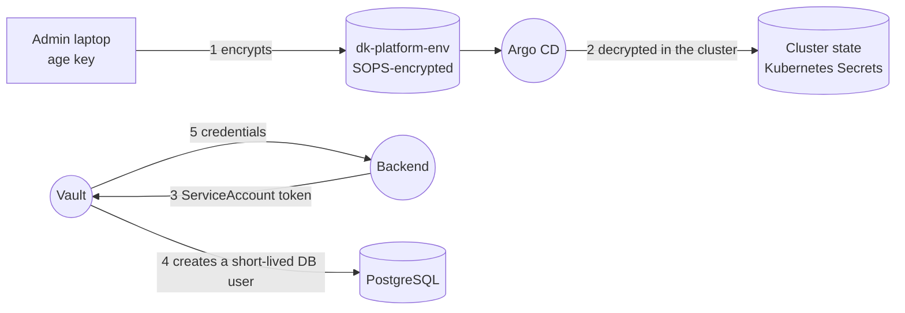
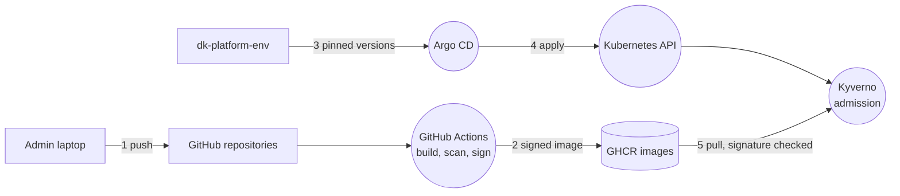
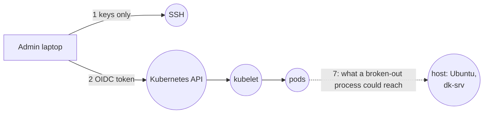
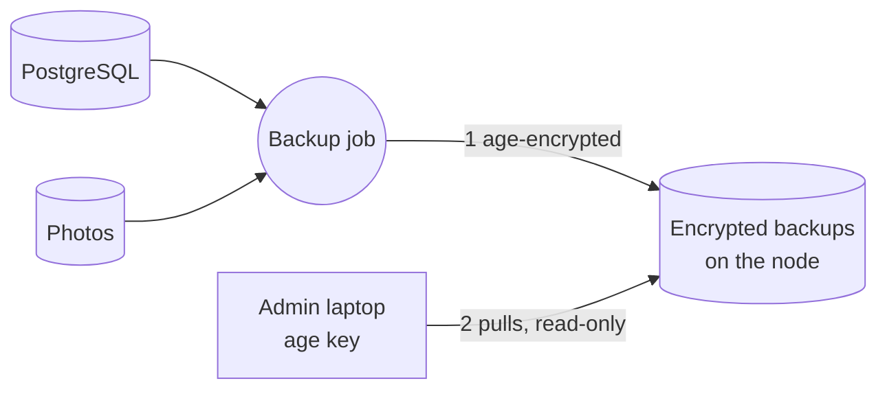

# Threat model: the target platform

What can go wrong in the [target architecture](architecture.md#target-a-hardened-k3s-node), and
what is done about it. Method: [ADR 0005](decisions/0005-threat-modelling-method.md) – the four
questions of the Threat Modeling Manifesto, data-flow diagrams, STRIDE per element plus a LINDDUN
pass for privacy, a 3×3 rating. Each threat (T-xx) leads to requirements (R-xx) in
[`security-requirements.md`](security-requirements.md), where they're built and checked phase by
phase. The temporary risks of the move itself are in
[`threat-model-transition.md`](threat-model-transition.md).

**Status:** first version, 2026-11-23 (phase 0). Reviewed at the end of every phase and whenever a
component or flow is added.

## How to read it

**STRIDE** – the six kinds of security threat, each breaking one property:

| | Threat | Breaks |
|---|---|---|
| S | Spoofing – pretending to be someone or something else | authentication |
| T | Tampering – changing data or code | integrity |
| R | Repudiation – denying an action, with no proof either way | accountability |
| I | Information disclosure – data reaching the wrong people | confidentiality |
| D | Denial of service – making it unavailable | availability |
| E | Elevation of privilege – doing more than allowed | authorization |

**LINDDUN** – privacy threats, used for the flows that carry personal data: **Li**nking,
**Id**entifying, **N**on-repudiation, **De**tecting, **D**ata disclosure, **U**nawareness,
**N**on-compliance. Marked like "LINDDUN: data disclosure".

**Rating** – likelihood × impact, each low / medium / high:

| | Impact | Likelihood |
|---|---|---|
| **High** | someone outside the circle of users reads or changes the content (photos, texts, positions), or takes over a login, the server or the platform; content lost beyond what the backups restore | happens automatically all the time on the internet (scanners, bots, password guessing), or one ordinary mistake is enough |
| **Medium** | someone inside the circle goes beyond their rights; the content unavailable for more than a day, or damaged but restorable; a security control silently off; content handed to a third-party service by design | needs a published vulnerability in something we run, or a specific situation (a crafted file, a misconfiguration that slips through) |
| **Low** | a short outage; no content affected; information that helps an attacker only a little | needs a targeted, skilled attacker, or several protections failing at once |

**Priority:** **high** = high/high, high/medium, medium/high – handled before go-live ·
**medium** = medium/medium, high/low, low/high · **low** = the rest.

**Responses:** mitigate · eliminate (remove the feature) · transfer (to someone else, the rest
recorded) · accept (deliberately, as a risk P-xx in [`SECURITY.md`](../SECURITY.md#accepted-risks-and-known-gaps)).

## 1. What are we working on?

### Scope

**In:** the k3s node and everything on it (edge, apps, identity, secrets, platform tools), the
flows to the outside world (users, the admin laptop, GitHub and the image registry, the
third-party services), the backups.

**Out:** the hosting provider's own access (hypervisor, console, snapshots – accepted as
[P1](../SECURITY.md#accepted-risks-and-known-gaps)); GitHub's and the third-party services' internal
security; the users' phones beyond the app; AWS (phase 8, its own model). The transition: its own
[document](threat-model-transition.md).

### Assumptions

Confirmed by the owner on 2026-11-23, or true by design. If one stops being true, the model is
reviewed.

| Assumption | Why it matters |
|---|---|
| The admin laptop's disk is encrypted and its screen locks automatically | it holds the age key, the SSH keys, later the cluster credentials |
| The GitHub account is protected with 2FA or a passkey | it's the root of the supply chain |
| The account managing the domain's DNS has 2FA | whoever changes DNS can get certificates for the domain |
| All accounts belong to people known personally; only the admin creates them | the circle of users is trusted, not anonymous |
| Only the admin has administrative access (SSH, cluster) | no second administrator to model |
| The hosting provider can technically access the server | out of scope, accepted as P1 |
| The code is public: attackers know the architecture and the versions | security doesn't rely on keeping the design secret |
| Third-party services (Nominatim, ntfy.sh, OpenStreetMap, Let's Encrypt, GitHub) act according to their published policies | what they receive is a disclosure by design, not a breach |

### Assets

| Asset | Matters most |
|---|---|
| Photos (originals and small versions) and texts of the storybooks | confidentiality, integrity |
| Exact positions of photos (never stored, but present in uploads) | confidentiality (privacy) |
| Who wrote what, perspectives, the change history | integrity, accountability |
| Logins and sessions | confidentiality, integrity |
| The platform's credentials: cluster admin, Argo CD's repository access, Vault's unseal keys and root token, the age keys, the CI's signing identity | confidentiality – each one opens a lot |
| The backups | confidentiality, integrity, availability |
| The service itself | availability (a family app – a day's outage is annoying, not critical) |

### Attackers (threat agents)

| Who | What they can do | Likelihood |
|---|---|---|
| Internet bots and scanners | probe every open port and known path, all the time | high |
| Password guessers | try common and leaked passwords against the login | high |
| Someone with a published exploit | use a vulnerability in something we run, soon after it's published | medium |
| A crafted file | reaches the photo parsers through an upload – a user may not know the file is crafted | medium |
| A compromised dependency, image or chart | brings its code into our images or cluster | low to medium |
| A user overstepping | someone in the circle trying more than their rights allow | low |
| A thief | a stolen phone (a user's session) or laptop (admin keys – disk encrypted) | low |
| The admin's own mistakes | a misconfiguration, a committed secret, a forgotten open port | medium |
| A targeted, skilled attacker | anything above, combined and patient | low – the app is private and not advertised |

### Data-flow diagram, level 0

The whole platform. Circles are processes, cylinders are data stores, rectangles are external
entities; each frame is a trust zone, so every arrow crossing a frame crosses a trust boundary.

The level-1 diagrams below zoom into one area each.

## 2. What can go wrong? – and 3. what are we going to do about it?

Columns: **L** likelihood, **I** impact, **P** priority (H/M/L); **R** the requirements that
answer the threat ([`security-requirements.md`](security-requirements.md)).

### a. Edge and app

| ID | Element / flow | Letter | Threat | L | I | P | Response | R |
|---|---|---|---|---|---|---|---|---|
| T-01 | login | S | passwords guessed or taken from other sites' leaks | H | H | **H** | mitigate | R-01, R-02 |
| T-02 | session cookie | S | a session stolen (an injection bug, a shared device) and used elsewhere | L | H | M | mitigate | R-03 |
| T-03 | flow 3 | T, E | another website makes a logged-in browser change memories (CSRF) | L | M | L | mitigate | R-04 |
| T-04 | backend | E | a user does more than allowed: someone else's perspective, later a storybook not shared with them | M | M | M | mitigate | R-05 |
| T-05 | flow 4 | I | a photo reachable without the login check – a route that skips ForwardAuth, a guessable path | M | H | **H** | mitigate | R-06 |
| T-06 | backend, frontend | T, E | injection: SQL in a query, script in a memory's text (stored XSS) | L | H | M | mitigate | R-07 |
| T-07 | flow 1 | I, T | traffic read or changed between phone and edge (old TLS, missing HSTS) | L | H | M | mitigate | R-08 |
| T-08 | Traefik, backend | D | floods and oversized requests exhaust the node | H | M | **H** | mitigate | R-09 |
| T-09 | Traefik, WAF plugin | E | a published vulnerability at the edge is exploited | M | H | **H** | mitigate | R-10 |
| T-10 | backend | R | a change to the content can't be traced to who made it | L | L | L | mitigate | R-11 |
| T-11 | all responses | I | error messages or headers reveal versions and internals | M | L | L | mitigate | R-12 |
| T-12 | backend | E | a vulnerability in the backend or its npm libraries gives code execution – and with it the backend's rights | M | H | **H** | mitigate | R-13, R-30 |

### b. The photo pipeline

The trust boundary is the worker itself: from there on, the file's *content* is untrusted,
whoever uploaded it.

| ID | Element / flow | Letter | Threat | L | I | P | Response | R |
|---|---|---|---|---|---|---|---|---|
| T-13 | worker | E | a crafted image exploits libvips or exiftool and runs code in the worker | M | M | M | mitigate (contain) | R-14 |
| T-14 | worker | D | a decompression bomb or a huge image exhausts memory | M | L | L | mitigate | R-15 |
| T-15 | worker | D | a photo that always crashes the worker blocks the queue forever | M | L | L | mitigate | R-15 |
| T-16 | photos, PostgreSQL (through a compromised worker) | T, I, D | a compromised worker reads, alters or deletes photos, or messes with the job table | L | H | M | mitigate | R-16 |
| T-17 | flow 6 | I · LINDDUN: data disclosure, linking | exact positions are sent to a third party (the OpenStreetMap Foundation runs Nominatim) | H | M | **H** | mitigate (proposed) | R-17 |
| T-18 | photos | I · LINDDUN: identifying | the exact position stays in the original when Nominatim can't be reached, until a retry | M | M | M | mitigate | R-18 |
| T-19 | photos | I · LINDDUN: identifying | other metadata stays in the originals (camera model and serial, time) | H | L | M | decide in phase 1 | R-19 |

### c. Identity

| ID | Element / flow | Letter | Threat | L | I | P | Response | R |
|---|---|---|---|---|---|---|---|---|
| T-20 | Keycloak | S, E | the admin console reached from the internet; an admin login taken over | M | H | **H** | mitigate | R-20 |
| T-21 | Keycloak | E | a published Keycloak vulnerability (they come often) is exploited | M | H | **H** | mitigate | R-21 |
| T-22 | flows 1, 2 | S, E | an OIDC mistake: open redirect URIs, missing PKCE or state, tokens not validated | M | H | **H** | mitigate | R-22 |
| T-23 | flow 2 | I | tokens leak to the browser, URLs or logs | L | H | M | mitigate | R-23 |
| T-24 | Keycloak | D | Keycloak down: nobody can log in – including the admin, if everything depends on it | M | M | M | mitigate | R-24 |
| T-25 | flow 4 | E | an app user gets rights in the platform tools because it's the same identity provider | L | H | M | mitigate | R-25 |

### d. Secrets

| ID | Element / flow | Letter | Threat | L | I | P | Response | R |
|---|---|---|---|---|---|---|---|---|
| T-26 | Git repositories | I | a secret committed in plain text | M | H | **H** | mitigate | R-26 |
| T-27 | age key | I | the age private key stolen: every secret in dk-platform-env readable, including its history | L | H | M | mitigate | R-27 |
| T-28 | cluster state | I, E | Kubernetes Secrets read through broad RBAC, a mounted token or the datastore file on disk | L | H | M | mitigate | R-28 |
| T-29 | Vault | E | Vault's root token or unseal keys misused | L | H | M | mitigate | R-29 |
| T-30 | flow 3 | S | a pod presents another workload's identity to get its credentials | L | H | M | mitigate | R-29 |

### e. Supply chain and GitOps

| ID | Element / flow | Letter | Threat | L | I | P | Response | R |
|---|---|---|---|---|---|---|---|---|
| T-31 | images | T | a malicious or compromised npm package ends up in an image | M | H | **H** | mitigate | R-30 |
| T-32 | flow 5 | T | an image replaced in the registry, or a tag moved to a different image | L | H | M | mitigate | R-31 |
| T-33 | repositories | T, E | a repository changed by someone else (account taken over) and deployed by Argo CD | L | H | M | mitigate | R-32 |
| T-34 | CI | E | the CI abused: an injected workflow step, an over-privileged token, unpinned third-party actions | M | H | **H** | mitigate | R-33 |
| T-35 | Argo CD | E | Argo CD itself taken over – it can deploy anything | L | H | M | mitigate | R-34 |
| T-36 | third-party charts | T | a platform component's chart or image changed or vulnerable | L | H | M | mitigate | R-35 |

### f. Admin access and the node

| ID | Element / flow | Letter | Threat | L | I | P | Response | R |
|---|---|---|---|---|---|---|---|---|
| T-37 | admin credentials | S, E | the cluster-admin credential stolen – full control | L | H | M | mitigate | R-36 |
| T-38 | Kubernetes API | S, E | the API reachable from the internet and attacked | M | H | **H** | mitigate | R-37 |
| T-39 | kubelet, internal ports | E | node ports other than 80/443 (and SSH) reachable from the internet | M | H | **H** | mitigate | R-38 |
| T-40 | SSH | S, E | SSH access taken over | L | H | M | mitigate | R-39 |
| T-41 | pods → host | E | a process breaks out of its container onto the node | L | H | M | mitigate | R-40 |
| T-42 | platform components | E | over-privileged components (network, runtime security, operators) used as a path to the node | L | H | M | mitigate | R-41 |
| T-43 | admin actions | R | changes to the cluster can't be traced | L | M | L | mitigate | R-42 |
| T-44 | configuration | T, I, E | the admin's own mistake: a policy hole, a service made public, a check switched off | M | H | **H** | mitigate | R-51 |

### g. Backup and restore

| ID | Element / flow | Letter | Threat | L | I | P | Response | R |
|---|---|---|---|---|---|---|---|---|
| T-45 | backups | I | backup files stolen from the node or the laptop | L | H | M | mitigate | R-43 |
| T-46 | backups | T, D | an attacker on the node alters or deletes the backups (ransomware-style) | L | H | M | mitigate | R-44 |
| T-47 | backup job | D | backups fail silently, or a restore doesn't work when it's needed | M | H | **H** | mitigate | R-45 |
| T-48 | backups | LINDDUN: unawareness | photos removed in the edit form stay in the backups, without the users knowing | H | L | M | accept – deliberately (see below) | – |

### h. Across the platform: monitoring, logs, egress

| ID | Element / flow | Letter | Threat | L | I | P | Response | R |
|---|---|---|---|---|---|---|---|---|
| T-49 | ntfy.sh | LINDDUN: data disclosure | the "login locked" notification passes a display name and an IP address through a public third-party server | M | L | L | mitigate (proposed) | R-46 |
| T-50 | logs | LINDDUN: linking, detecting | access logs (edge, Keycloak, Loki) keep IP addresses and times – who visited when | H | L | M | mitigate | R-47 |
| T-51 | monitoring | D | the alerting itself fails, so an attack or outage goes unnoticed | M | M | M | mitigate | R-48 |
| T-52 | Grafana, Prometheus, Loki | I | the monitoring tools reachable and showing logs with personal data | M | M | M | mitigate | R-49 |
| T-53 | all pods | D | one component (often logs or metrics filling the disk) takes the others down | M | M | M | mitigate | R-50 |
| T-54 | all pods → internet | I | a compromised pod sends data out | L | H | M | mitigate | R-52 |

**T-48, accepted deliberately:** the backups keep every photo ever uploaded – that's their purpose
(a photo removed by mistake can be restored). The users are told when the platform goes live
(R-59 in the transition), which answers the "unawareness".

## 4. Did we do a good enough job?

- **Summary:** 54 threats – 16 of priority high, 31 medium, 7 low – answered by 52
  requirements; the transition adds 7 threats and 7 requirements. Every high one is handled before
  go-live; one threat is accepted deliberately (T-48), and the hosting provider's access is out of
  scope and accepted (P1).
- **The 16 of priority high:** the login and the edge (T-01, T-05, T-08, T-09), the backend's
  dependencies (T-12), positions sent to Nominatim (T-17), identity (T-20, T-21, T-22), a committed
  secret (T-26), the supply chain (T-31, T-34), access to the cluster (T-38, T-39), the admin's own
  mistakes (T-44) and backups that don't restore (T-47). Mistakes are the reason so many
  requirements are automated checks rather than good intentions.
- **What's better than today:** hostile files no longer reach the backend's rights (T-12 vs T-13);
  egress is per pod, not per server (T-54); only signed images run (T-32); database credentials
  are short-lived (T-29).
- **What's new compared with today:** the Kubernetes API, Argo CD, the cluster's own secrets,
  Keycloak as one place for all logins, the CI's signing identity – each a high-value target
  (T-20 to T-22, T-28, T-35, T-37, T-38).
- **Reviews:** at the end of every phase (are the phase's requirements met? anything new to
  model?), and before go-live (all high-priority requirements ✅).
